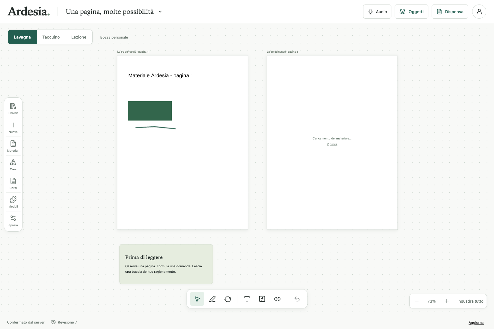

# Evidenze della consegna Ardesia — 7 novembre 2026

[Handoff](../../docs/handoffs/2026-11-07.md) · [Confronto col programma e le chat](../../docs/handoffs/confronto-programma-chat-2026-11-07.md).

Sorgente locale verificata **290f597d24ea4ef92769faab9b309069ed9e50dd2fd9f8b778c460e186b12c82**, base Git f7adf5d più working tree. I report originali non sono rietichettati con il commit pubblicato successivamente. Il digest e source-files.json identificano gli stessi byte; CI della PR verifica poi il proprio commit. Eventuale CI pending non è PASS.

**Verify8/8,552test,191browser, server5, MCP15**, zero fallimenti/saltati/flaky nella run corretta. [Report locale](local-result.json) · [Review indipendente materiali](checks/materials/review/final-review.md). Conservati190PASS/1FAIL della regressione focus e gli altri tentativi, non accettazioni del candidato finale. Il prodotto resta NOT_COMPLETE; nessun merge/deploy o app nativa attestato.

Gli archivi REA contengono raw, screenshot, manifest, licenze, fonti selezionate, limiti e analisi delle aree; decomprimere con tar -xzf. I vecchi report restano riferiti alle proprie sorgenti. Le prove test pubblicate comprendono JSON/log/review, non sessioni/trace browser, database o trascrizioni private. L’inventario locale originale può elencare artefatti non duplicati nel repository: il manifest di questo pacchetto descrive esattamente quanto pubblicato.

Materiali: due scenari da21passi,42totali, su Chrome Mac/viewport mobile. Annotation fixture precreata; REA sposta la pagina e osserva la riapertura. Upload/draw e download byte-identico sono Playwright; REA cancella i propri download.401 iniziale è session discovery anonima prima del login. Fonti/byte server associati separatamente, non certificati dal solo REA.

Gli archivi sono conservati una sola volta per questa consegna. I prossimi incrementi devono riferire questi percorsi/hash e aggiungere soltanto nuove evidenze, senza duplicare il patrimonio. Nessuno di questi archivi entra nel runtime o nel budget applicativo.
